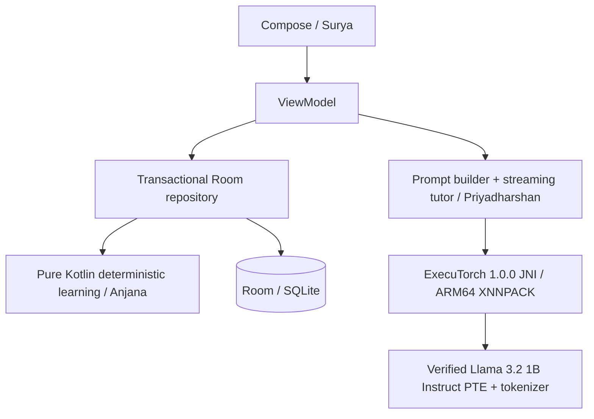

# ADAPT-AI architecture — v2

The original implementation began in an empty workspace. The completion audit retained all four working modules and the installed learner database. Current target is the connected Realme P4 Pro 5G (RMX5116), not the original Narzo target. Full findings and priorities are in `ENGINEERING_AUDIT.md`.

Build tools are isolated under `.tools/`: JDK 21, Android SDK 35 and Gradle. Actual device facts and validation evidence are in `reports/device-probe.json` and `reports/DEVICE_VALIDATION.md`.

## Boundaries

Modules: `:core` JVM domain and curriculum; `:data` Android Room and repository; `:inference` Android ExecuTorch adapter; `:app` Compose MVVM integration. Dependencies point inward to core. Runtime uses the official packaged JNI; no custom JNI required.

Only scored curated assessment answers update mastery, inside a Room transaction that also stores the answer, revision schedule and refreshed roadmap. Structured tutor output is buffered until strict validation; invalid raw output is never displayed or stored. Inference cannot invoke repository mutations. No INTERNET permission. Models are user-imported through Android document picker, hashed, native-load validated and stored privately before atomic activation. Missing models produce an explicit unavailable state, never synthetic inference.

## Learning policy v1

Directed acyclic prerequisite graph, goal-specific relevance. BKT-inspired posterior with guess/slip and learning transition; conservative prerequisite threshold 0.70, target mastery 0.85. Wrong answers record curated misconception tags. Assessment selection balances uncertainty, coverage and goal relevance; remedial prerequisites remain assessable. Answers are immutable and idempotent by session/question. Revision uses scored recall with bounded ease and intervals. Roadmap packs eligible activities within daily budget, defers locked skills and reports blockers. No diagnostic score is a validated psychometric measure.

## Frozen toolchain

Gradle 8.11.1; AGP 8.9.1; Kotlin/Compose compiler 2.1.20; KSP 2.1.20-1.0.32; JDK 21; compile/target SDK 35; min SDK 28; Room 2.7.1; ExecuTorch 1.0.0. Exporter also v1.0.0; never mix arbitrary main-branch configs with released runtime.

## Risks and release gates

1. Meta model access/license and weights unavailable: user must obtain authorized Llama 3.2 1B Instruct original checkpoint/tokenizer. Do not commit weights or credentials.
2. Phone/ADB access is established. Core UI, migration and persistence are exercised physically. JNI initialization is tested independently; actual PTE generation remains a separate gate. CPU flags do not prove per-operator NEON execution.
3. PTE/export compatibility and tokenization: paired checksummed manifest, context 2048, exact exporter release; actual export and generation are release gates.
4. CPU memory/thermals: bounded prompt, one generation at a time, native stop, lifecycle cleanup; measure cold/warm load, TTFT, runtime token rate, RSS/PSS and thermals. No NPU claim.
5. The 64-question curated bank and fixed BKT-inspired parameters limit generalisation and repeat-test validity. Independent content review and calibration remain necessary before educational deployment.
6. APK compilation is necessary but insufficient. Phone journey in airplane mode and process-death persistence must pass before competition-ready claim.
