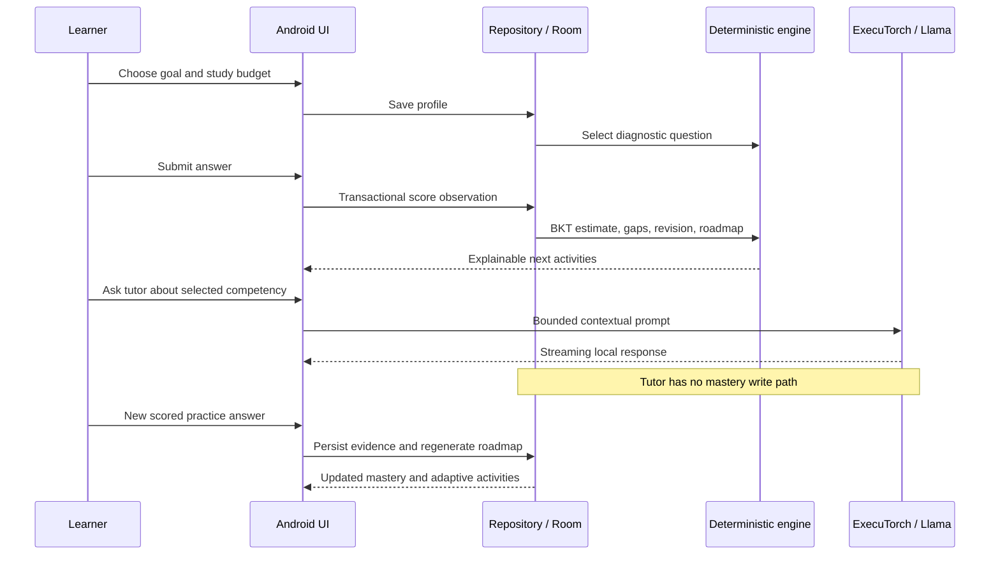

# ADAPT-AI — ARM Bharat AI SoC Challenge PS4

## Submission state

An existing Android project improved incrementally to version 0.2.0: deterministic adaptive learning, persistent learner evidence, richer Compose UI, native ExecuTorch integration and conversion/benchmark tooling. Core learning, Room migration and restart behavior have physical offline test evidence on the Realme P4 Pro 5G. Real Llama generation, quality and inference performance remain blocked by absent authorized artifacts. See the current completion matrix and raw reports; native loading is not equivalent to PTE execution.

## Problem and approach

Learners need a bridge from career ambition to daily action. ADAPT-AI collects a goal and study budget, measures competency with curated questions, estimates mastery, exposes gaps and proposes prerequisite-respecting activities. A local Llama tutor explains the selected competency using the learner's recent context. Subsequent scored evidence updates the deterministic plan.

Privacy and offline operation are architectural: no network permission, no cloud inference dependency, private SQLite storage, local curriculum and user-imported model files. Model provisioning is a separate USB/document-import step. No proprietary NPU SDK is assumed.

## Acceptance journey

## Engineering decisions

- Pure Kotlin core permits quick host tests independently of model and phone availability.
- Room transactions keep answers, mastery, misconceptions, recall and roadmap consistent. Duplicate/stale submissions cannot double-score.
- Released ExecuTorch 1.0.0 Java API inspected from Maven AAR; matching exporter release checked at export time. Official packaged JNI avoids an unnecessary custom native bridge.
- ARM64-only package and CPU/XNNPACK target; native generation executes in the background, supports stop and releases memory when app backgrounds.
- JSON is a teaching format, not an action protocol. Invalid generation cannot unlock competencies or alter scores.
- Readable roadmap reasons and an honest unassessed state avoid presenting a prior as an actual test result.

## Ownership and handoff

| Owner | Scope | Handoff |
|---|---|---|
| Surya | Android UI, ViewModel, integration | `app/`, release signing, phone UX recording |
| Priyadharshan | Llama export, ExecuTorch, ARM optimization | `inference/`, `models/`, benchmark scripts and measured reports |
| Anjana | Graph, assessment, mastery, adaptation | `core/`, curated question review, learning-policy calibration |

## Limitations and release gates

Eight competencies, three career directions and 64 curated questions provide a focused vertical slice. Eight questions per skill cannot establish real-world proficiency; repeated sessions can reward memorization. BKT parameters and thresholds are heuristics awaiting calibration. Wrong answers cannot increase mastery; 5-minute plans remain actionable; due recall survives prerequisite decline. Profile experience affects tutoring context, never initial mastery or unlocks. Structured responses are buffered until strict validation and invalid raw output is discarded.

Physical UI evidence covers onboarding, scoring, adaptation and restart on Android 16. Wider device/font/accessibility testing, real generated-content evaluation, native cancellation under a loaded model, thermals and quantization tradeoffs remain necessary. Educational efficacy has not been measured. Release code is built without debug tooling, but external team signing and actual model acceptance remain release gates.

Competition readiness requires the actual offline acceptance journey, model-quality review, ARM evidence and a team-signed APK. Documentation and a compiling native adapter alone do not satisfy those gates.
